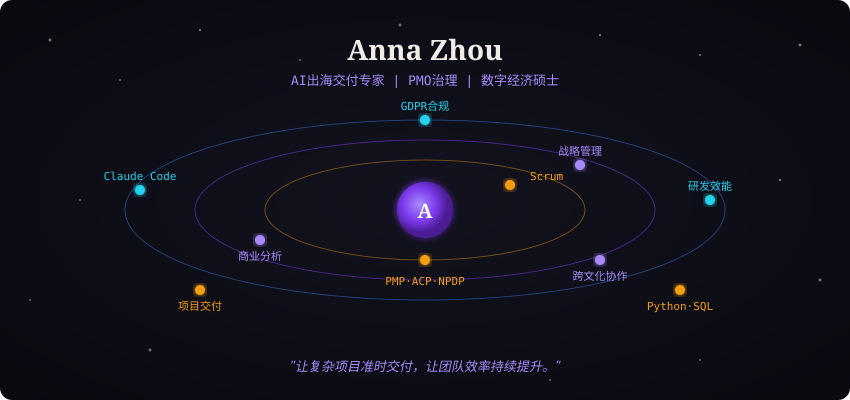

<div align="center">
  
</div>

<br/>

<!-- =========== ABOUT ME =========== -->

<div align="center">

### 🧑‍💻 About Me

```yaml
name: Anna Zhou
identity: 高级项目经理 / AI出海交付专家
career: 产品经理 → Scrum Master → PMO高级项目经理 → AI出海负责人
experience: 10+ years in internet product & project management
focus: AI影像产品出海 · 研发效能 · PMO治理 · 战略落地
markets: 🇨🇳 🇺🇸 🇧🇷
certifications: PMP · ACP · NPDP · 软考高项（信息系统项目管理师）
education: 中山大学 · 数字经济硕士在读
superpower: 用 AI 重构项目管理流程
motto: 让复杂项目准时交付，让团队效率持续提升
```

🚀 主导 AI 影像产品美国 & 巴西出海专项，按期交付率 95%+ &nbsp;·&nbsp;
🤖 自研 AI 诊断工具识别流程瓶颈，团队效率提升 40% &nbsp;·&nbsp;
🌏 英语商务流利，可主持英文会议与跨时区协作

🛠️ 四证持有（PMP/ACP/NPDP/软考高项）&nbsp;·&nbsp;
📚 中山大学数字经济硕士在读 &nbsp;·&nbsp;
🎯 信奉「PMO + AI = 下一代交付效率引擎」

</div>

<br/>

<div align="center">
  
</div>

<br/>

<!-- ========== MARKETS ========== -->

<div align="center">

### 🌏 出海市场足迹

*主导 AI 影像与音频社交产品覆盖的核心市场*

<br/>

[](https://github.com/Annaok123)
&nbsp;
[](https://github.com/Annaok123)
&nbsp;
[](https://github.com/Annaok123)

<br/>

[](https://github.com/Annaok123)
[](https://github.com/Annaok123)
[](https://github.com/Annaok123)

</div>

<br/>

<!-- ========== SKILL TREE ========== -->

<div align="center">

### 🎯 Skill Tree

*从战略到执行，从交付到分析 —— 完整的项目管理能力图谱*

<br/>

| 领域 | 熟练度 | 进度 | 常用工具 / 方法论 |
|:---:|:---:|:---|:---|
| 🚀 AI 项目交付 | ⭐⭐⭐⭐⭐ | 🟪🟪🟪🟪🟪🟪🟪🟪🟪🟪 `100%` | Scrum · SAFe · DevOps |
| 📊 研发效能治理 | ⭐⭐⭐⭐⭐ | 🟪🟪🟪🟪🟪🟪🟪🟪🟪🟪 `100%` | Jira · DORA · AI诊断 |
| 🎯 战略管理 | ⭐⭐⭐⭐ | 🟪🟪🟪🟪🟪🟪🟪🟪⬜⬜ `80%` | OKR · 战略解码 · 复盘 |
| 📈 商业分析 | ⭐⭐⭐⭐ | 🟪🟪🟪🟪🟪🟪🟪🟪⬜⬜ `80%` | 需求分析 · ROI · 数据驱动 |
| 🌏 出海合规 | ⭐⭐⭐⭐ | 🟪🟪🟪🟪🟪🟪🟪🟪⬜⬜ `80%` | GDPR · LGPD |
| 🤖 AI 辅助编程 | ⭐⭐⭐⭐ | 🟪🟪🟪🟪🟪🟪🟪🟪⬜⬜ `80%` | Claude Code · Codex · Cursor |
| 💰 预算与成本管理 | ⭐⭐⭐⭐ | 🟪🟪🟪🟪🟪🟪🟪🟪⬜⬜ `80%` | 立项 · 预算编制 · 成本管控 |
| ⚠️ 风险管理 | ⭐⭐⭐⭐ | 🟪🟪🟪🟪🟪🟪🟪🟪⬜⬜ `80%` | 风险登记册 · 前置识别 · 应急预案 |
| 🧭 产品规划 | ⭐⭐⭐ | 🟪🟪🟪🟪🟪🟪⬜⬜⬜⬜ `60%` | 路线图 · MVP · 优先级排序 |
| 📉 数据分析 | ⭐⭐⭐ | 🟪🟪🟪🟪🟪🟪⬜⬜⬜⬜ `60%` | Python · SQL · Pandas |
| 🤝 智能体搭建 | ⭐⭐⭐ | 🟪🟪🟪🟪🟪🟪⬜⬜⬜⬜ `60%` | Coze · Dify · N8n |
| 🌐 跨文化沟通 | ⭐⭐⭐⭐⭐ | 🟪🟪🟪🟪🟪🟪🟪🟪🟪🟪 `100%` | 商务英语 · 跨时区协作 · 海外团队 |

</div>

<br/>

<!-- ========== TOOLBOX ========== -->

<div align="center">

### 🛠️ Toolbox

<br/>

**💻 AI 编程与提效**

[](https://github.com/Annaok123)
&nbsp;
[](https://github.com/Annaok123)
&nbsp;
[](https://github.com/Annaok123)
&nbsp;
[](https://github.com/Annaok123)

<br/>

**📋 项目管理与协作**

[](https://github.com/Annaok123)
&nbsp;
[](https://github.com/Annaok123)
&nbsp;
[](https://github.com/Annaok123)
&nbsp;
[](https://github.com/Annaok123)
&nbsp;
[](https://github.com/Annaok123)

<br/>

**📊 数据与商业分析**

[](https://github.com/Annaok123)
&nbsp;
[](https://github.com/Annaok123)
&nbsp;
[](https://github.com/Annaok123)
&nbsp;
[](https://github.com/Annaok123)
&nbsp;
[](https://github.com/Annaok123)

<br/>

**🧠 战略与方法论**

[](https://github.com/Annaok123)
&nbsp;
[](https://github.com/Annaok123)
&nbsp;
[](https://github.com/Annaok123)
&nbsp;
[](https://github.com/Annaok123)
&nbsp;
[](https://github.com/Annaok123)

<br/>

**🤝 认证徽章**

[](https://github.com/Annaok123)
&nbsp;
[](https://github.com/Annaok123)
&nbsp;
[](https://github.com/Annaok123)
&nbsp;
[](https://github.com/Annaok123)

</div>

<br/>

<!-- ========== GITHUB ACTIVITY ========== -->

<div align="center">

### 📊 GitHub Activity

<br/>

<a href="https://github.com/Annaok123">
  
</a>

<br/><br/>

<picture>
  <source media="(prefers-color-scheme: dark)" srcset="https://raw.githubusercontent.com/Annaok123/Annaok123/output/github-snake-dark.svg" />
  <source media="(prefers-color-scheme: light)" srcset="https://raw.githubusercontent.com/Annaok123/Annaok123/output/github-snake.svg" />
  
</picture>

</div>

<br/>

<!-- ========== PHILOSOPHY & CONNECT ========== -->

<div align="center">

### 💡 Philosophy

> *"好的项目管理，不是让每个人都忙碌，而是让每个人都清楚自己在为什么而战。"*
>
> *"风险不是报告里的数字，是在它变成问题之前就去解决它。"*
>
> *"战略决定做正确的事，执行决定把事做正确。"*

<br/>

`🚀 AI出海交付  ×  📊 战略与商业分析  =  🌏 全球化产品落地`

<br/>

---

**📫 Let's Connect**

如果你也在探索 AI 项目出海、研发效能提升，或对 PMO + AI 的协作方式感兴趣，欢迎交流！

<br/>

[](https://annaok123.github.io/Anna-blog/)
&nbsp;
[](https://github.com/Annaok123/Life-Wiki)
&nbsp;


<br/>

---

<sub>🚀 Powered by AI-Assisted PM &nbsp;|&nbsp; 10+ Years Project Management &nbsp;|&nbsp; AI × 出海 = 无限可能</sub>

<br/>

</div>
